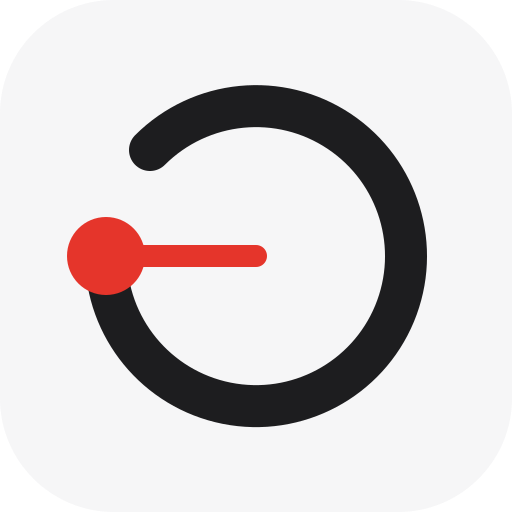
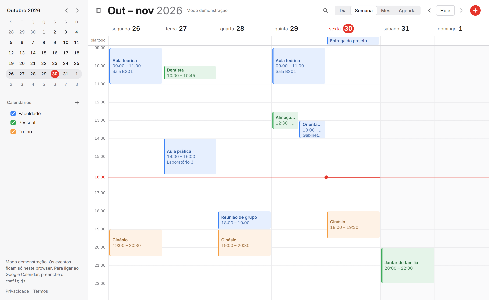
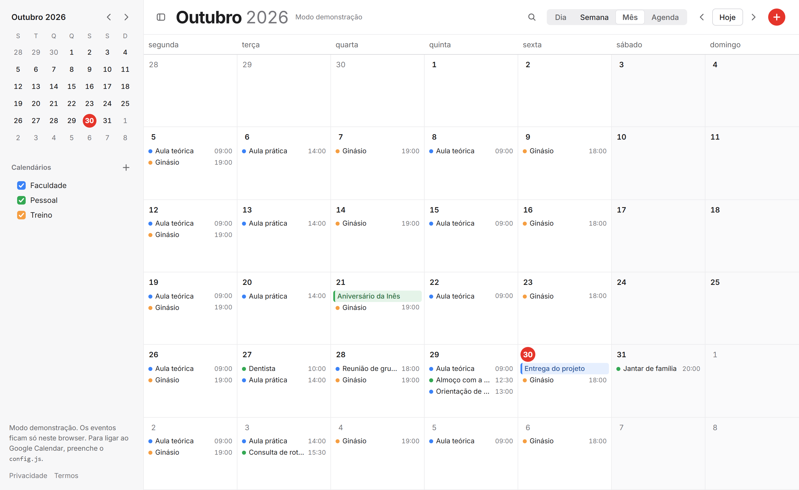
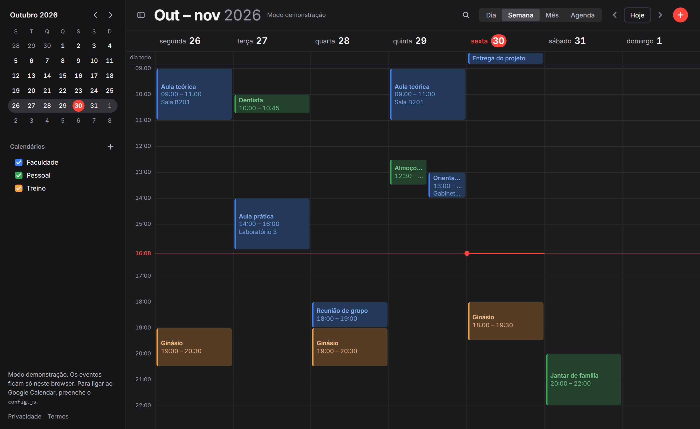

<p align="center">
  
</p>

<h1 align="center">Chronos</h1>

<p align="center">A minimal calendar for Google Calendar, installable as an app.</p>

<p align="center"><a href="https://miguelsiilva1.github.io/Chronos/"><strong>Open Chronos</strong></a></p>







The screenshots show demo mode.

## Why

Google Calendar does a lot, and its interface shows all of it. Chronos keeps the part used every day: a clean view of your time, across all your Google accounts, in one window. It is a static site with no build step, plus one small Worker that keeps you signed in, so anyone can host a copy for free.

## Features

- Day, week and month views, with the week starting on Monday and a 24-hour clock
- Red "now" line in the day and week views, updated every minute
- Drag in a column to create an event, snapped to 15 minutes
- Several Google accounts at the same time, with calendars grouped by account
- Create, edit, delete and move events between calendars and accounts
- Repeating events, with daily, weekday, weekly, monthly, yearly and custom rules
- Edit or delete one occurrence, this and the following ones, or the whole series
- Stay signed in, with access renewed in the background
- Mini calendar and show or hide controls for each calendar
- Create, rename, recolour and delete calendars
- Drag calendars to reorder them. The order stays in your browser
- Side panel with the upcoming events of a calendar
- Sync on focus and every 5 minutes
- Keyboard shortcuts
- Automatic light and dark themes
- Responsive layout, with a drawer sidebar on phones
- Installable as a PWA, and the app shell opens offline
- Demo mode with sample calendars when no client ID is set
- Portuguese (Portugal) interface

## Getting started

### Host on GitHub Pages

1. Fork this repository.
2. Open **Settings > Pages**.
3. Under **Build and deployment**, set **Source** to **Deploy from a branch**.
4. Select the `main` branch and the `/ (root)` folder, then click **Save**.

This repository's `config.js` holds a client ID and a Worker URL that only work on its own origin. In your copy, replace them with your own, or leave the client ID empty to run in demo mode. Also replace the Worker URL in the `connect-src` list of the Content Security Policy in `index.html`.

### Run locally

```bash
python -m http.server 8000
```

Open <http://localhost:8000>.

### Create the OAuth client

Do these steps in the [Google Cloud console](https://console.cloud.google.com/).

1. Create a project.
2. Open **APIs & Services > Library** and enable the **Google Calendar API**.
3. Open the **OAuth consent screen** and choose **External**. Add your home page, privacy policy and terms links.
4. Add these scopes:
   - `https://www.googleapis.com/auth/calendar.events`
   - `https://www.googleapis.com/auth/calendar.calendarlist`
   - `https://www.googleapis.com/auth/calendar.calendars`
   - `openid`
   - `email`
5. Open **Credentials** and create an **OAuth client ID** of type **Web application**.
6. Add these **Authorized JavaScript origins**:
   - `https://miguelsiilva1.github.io`
   - `http://localhost:8000`
7. Copy the client ID into `config.js` and `worker/wrangler.toml`.
8. Open **Audience** and click **Publish app**. Refresh tokens expire after 7 days while an app stays in test mode.

If you host your own copy, use your own origin in step 6. The client ID is public by design, so it is safe to commit. The client secret is not: it goes only into the Worker.

### Deploy the auth Worker

You need a free [Cloudflare](https://www.cloudflare.com/) account.

1. Set `ALLOWED_ORIGINS` in `worker/wrangler.toml` to your origins.
2. Run these commands in the `worker` folder:

   ```bash
   npx wrangler login
   npx wrangler deploy
   npx wrangler secret put GOOGLE_CLIENT_SECRET
   npx wrangler secret put SESSION_KEY
   ```

   For `SESSION_KEY`, paste the output of `openssl rand -base64 32`.
3. Copy the Worker URL into `CHRONOS_AUTH_URL` in `config.js`.

## Keyboard shortcuts

| Key | Action |
| --- | --- |
| `←` / `→` | Previous / next |
| `T` | Today |
| `D` | Day view |
| `S` | Week view (*semana*) |
| `M` | Month view |
| `N` | New event |
| `Esc` | Close |

Shortcuts are off while you type in a field. To reorder a calendar with the keyboard, focus it and press `Alt` + `↑` or `↓`.

## How it works

| File | Role |
| --- | --- |
| `index.html` | Page structure and the event editor dialog |
| `styles.css` | Design tokens, themes and layout |
| `app.js` | Views, Google sign-in, Calendar API calls and demo mode |
| `config.js` | The Google client ID and the Worker URL |
| `privacy.html`, `terms.html` | Privacy policy and terms |
| `manifest.webmanifest` | PWA name, icons and display mode |
| `sw.js` | Caches the app shell, network first. It never touches Google requests |
| `worker/` | Cloudflare Worker that exchanges and renews Google tokens |
| `fonts/` | Inter, served with the app, and its license |
| `icons/` | App icon as SVG and PNG |
| `docs/` | Screenshots for this README |

The browser calls the Calendar API directly, so events never pass through the Worker.

The Worker holds the client secret. It encrypts each refresh token with AES-GCM and returns it to the browser as an opaque session, which changes on every renewal. The Worker stores nothing. Access tokens stay in memory and last 1 hour.

## Limitations

- **The app is not verified by Google.** Sign-in shows a warning, and Google caps unverified apps at 100 users for the life of the project.
- **A session ends after 90 days without use, or when you remove the account or revoke access.** The encrypted session stays in `localStorage`, so anyone who controls your browser profile can use it. Do not use Chronos on a shared computer.
- **Reconnecting needs one click per account.** If Google ends a session, Chronos keeps your calendar list and shows **Sessão expirada · reativar** at the top.
- **Removing an account ends its access everywhere.** Revoking the grant also signs Chronos out on your other devices.
- **Moving a repeating occurrence creates a new event.** The Calendar API cannot move a single instance, so Chronos creates a one-off event and deletes that occurrence. The same applies to moves between accounts. Guests and attachments are not copied.
- **Splitting a series drops its changes.** "This and following" starts a new series, so edits to single later occurrences are lost.

## License

[MIT](LICENSE)
